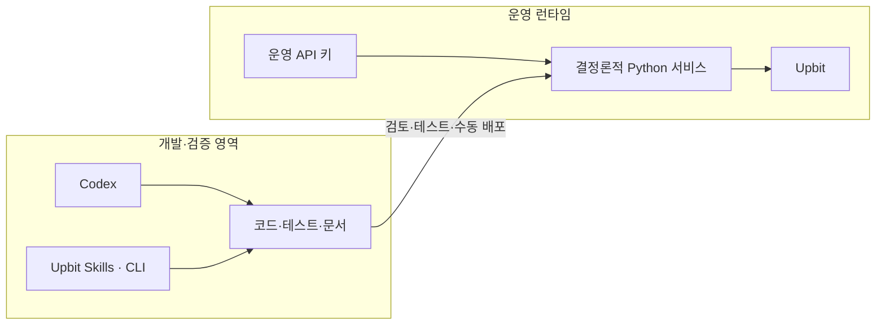
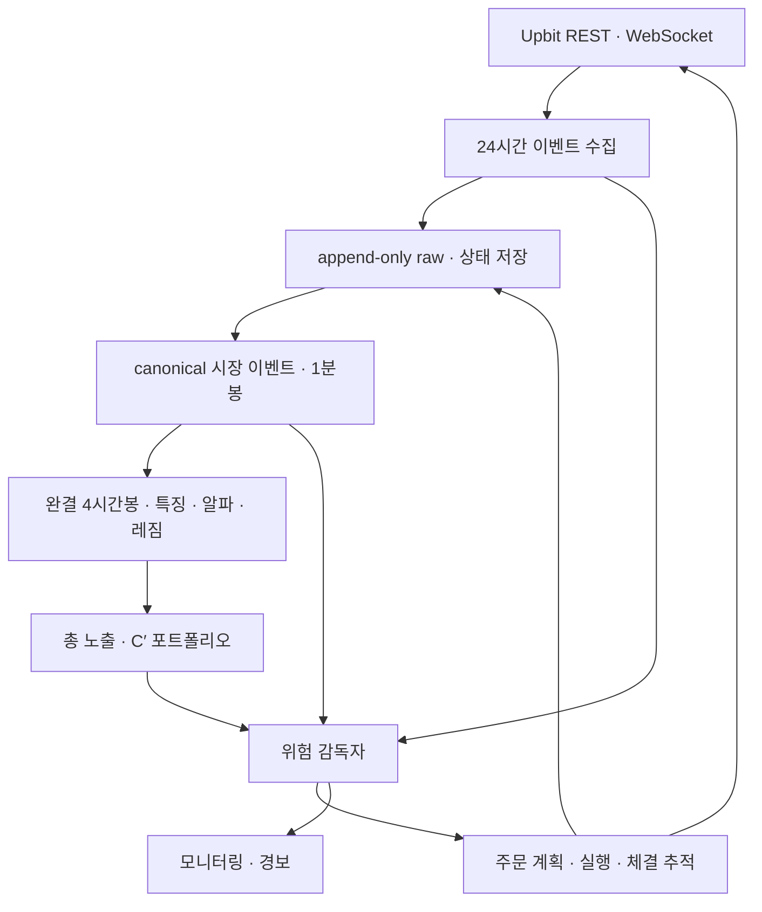
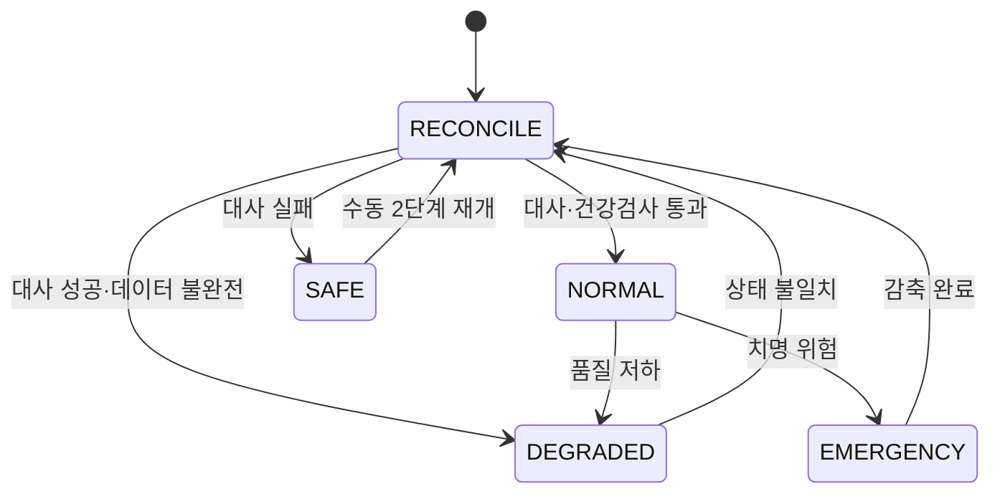
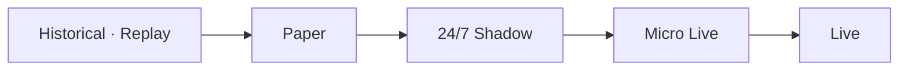

# Cassandra Project Blueprint v1.0

> 업비트 KRW 현물시장을 위한 24/7 롱·현금 자동매매 시스템

| 항목 | 내용 |
|---|---|
| 문서 상태 | 구현 기준선(Baseline) |
| 기준일 | 2026-08-22 |
| 대상 버전 | Cassandra v1.0 |
| 개발 환경 | OMEN 노트북 · Windows/WSL2 Ubuntu · VS Code |
| 운영 환경 | 서울 리전 Linux VPS · 24/7 |
| 거래 범위 | Upbit KRW 현물 · Long/Cash · 무레버리지 |
| 최우선 원칙 | 수익성보다 재현성, 안전성, 복구 가능성을 먼저 검증 |

---

## 1. 프로젝트 정의

카산드라는 업비트 KRW 현물시장에서 여러 종목의 상대적 기회를 평가하고, 시장 위험에 따라 전체 암호자산 노출을 0~100% 사이에서 조절하는 자동매매 시스템이다.

운영 기준선은 다음과 같다.

> 카산드라는 24시간 이벤트 기반으로 시장 및 계좌와 통신한다.
>
> 알파·레짐·포트폴리오 의사결정은 완결된 4시간봉마다 수행하며,
> 위험관리·주문 집행은 실시간으로 수행하고 체결·잔고 변화는 WebSocket으로 실시간 추적한다.
> 계좌 대사는 시스템 기동 시, WebSocket 재접속 시, 주문 종료 상태 도달 시, 정해진 주기에 REST로 조회한 기준 상태와 내부 상태를 비교해 수행하며, WebSocket 이벤트만을 계좌의 최종 진실로 간주하지 않는다.
>
> 목표 평균 보유기간은 약 7일이지만 고정 또는 최소 보유기간은 아니다.

### 1.1 v1의 제품 목표

- API 키 없이 시작하는 읽기 전용 데이터 수집부터 실거래까지 하나의 검증 경로를 만든다.
- 연구·백테스트·페이퍼·섀도·실거래가 같은 전략 코드와 내부 데이터 타입을 사용한다.
- 24시간 켜진 클라우드 서버가 수집·추론·주문·대사·감시를 담당한다.
- OMEN 노트북은 개발, 대규모 백테스트, 모델 학습에만 사용한다.
- 자본금이 100만원이든 5,000만원 이상이든 NAV와 유동성에 맞춰 주문 크기가 자동으로 변한다.
- 장애나 재시작 뒤에도 중복 주문 없이 거래소 상태와 대사할 수 있다.

### 1.2 v1 완료의 정의

v1 완료는 “가장 최신 모델을 넣었다”가 아니라 다음 상태를 뜻한다.

1. 동일한 전략 코드가 replay, paper, shadow, live 어댑터 위에서 작동한다.
2. 24시간 연속 paper/shadow 실행에서 데이터, 의사결정, 주문, 대사, 복구 경로가 확인된다.
3. 프로세스 강제 종료, 통신 단절, 중복 이벤트, 부분 체결을 넣어도 중복 주문과 미해결 원장 불일치가 없다.
4. 비용 포함 walk-forward 결과와 2배 비용 스트레스 결과를 재현할 수 있다.
5. 운영 승격·중지·축소·롤백이 사람의 명시적 승인 아래 이루어진다.

마이크로 라이브에 들어가기 전에는 최소 1주 이상의 shadow soak test를 권장한다.

### 1.3 v1 비목표

- 공매도, 레버리지, 파생상품
- 다중 거래소 운용
- TimesNet, PatchTST, ModernTCN의 운영 Champion 투입
- 뉴스·온체인·거시 데이터의 핵심 알파 투입
- 전용 웹 대시보드
- LLM 또는 자연어 에이전트의 실시간 주문 판단
- 모델의 자동 실거래 승격
- 자동 출금

---

## 2. 확정된 설계 결정

| 영역 | v1 결정 |
|---|---|
| 시장 | Upbit KRW 현물, Long/Cash |
| 운영 통신 | 클라우드에서 24시간 이벤트 기반으로 시장·계좌와 통신 |
| 기본 시장 감시 | WebSocket ticker·1분봉을 계속 수신하고 canonical 1분봉으로 정규화 |
| 선별 미시구조 | 체결·호가는 보유 종목, 상위 매수 후보, 현재 주문 대상 중심으로 수집 |
| 정상 의사결정 | 완전히 닫힌 4시간봉마다, 하루 6회 |
| 실시간 경로 | 위험 한도·kill switch, 주문 집행, WebSocket 체결·잔고 변화 추적 |
| 계좌 대사 | 시스템 기동·WebSocket 재접속·주문 종료 상태·정해진 주기에 REST 기준 상태와 내부 상태를 비교해 수행 |
| 주 예측 수평선 | 7일 |
| 목표 평균 보유기간 | 약 7일의 목표 회전율; 고정·최소·최대 보유기간이 아니며 조기 매도·장기 보유 모두 허용 |
| 유니버스 | 시점별 최근 30일 거래대금 상위 약 30개 적격 KRW 종목 |
| 알파 Champion | Elastic Net + LightGBM/LambdaRank |
| 레짐 Champion | 해석 가능한 연속 점수; 총 노출 0~100% |
| 종목 수 | 고정 K 없음; 엣지·비용·불확실성·유동성으로 결정 |
| 종목당 한도 | 모든 비중 한도는 전체 계좌 NAV 기준; 종목당 NAV 20% 절대 안전 상한 |
| 현금 | 의무 하한 없음; 총 노출과 적격 종목·비중 한도를 적용한 뒤의 잔여분 |
| 위험자산 배분 | 강건 C′ 목적함수; 슬리브 내부 상대 비중은 정규화하되 계좌의 위험자산 100% 투자는 강제하지 않음 |
| 1차 모델 평가 | walk-forward Net Calmar의 구간 중앙값 |
| 2차 평가 | Net Sharpe, 기간·레짐 안정성, 2배 비용 스트레스 |
| 낙폭 목표 | OOS·스트레스 MDD 20% 이하를 목표로 하되 보장하지 않음 |
| 손절·익절 | Champion에는 고정 손절·익절 없음 |
| 운영 승격 | 자동 승격 없음; shadow 검증 후 수동 승인 |
| 클라우드 | VPS 24/7 실행, OMEN은 개발·학습 전용 |
| 자본 한도 | `max_authorized_nav`와 별도 확대 승인 변수 없음; 의사결정 시 실제 계좌 NAV에 자동 적응 |
| 운영 계좌 | 자동매매 전용 계좌/포켓, 봇 실행 중 수동 거래 금지 |

---

## 3. 시스템 경계와 설계 원칙

### 3.1 결정론적 운영 코어

운영 주문 경로에는 LLM을 넣지 않는다. Codex, Upbit Agent Skills, Upbit CLI는 개발·문서 확인·테스트·운영 절차 작성에만 사용한다. 실제 운용은 검증된 Python 코드, 버전이 고정된 모델, 승인된 설정만 실행한다.



### 3.2 공통 불변조건

- 모든 저장 시각과 판단 기준은 UTC, 사용자 표시와 보고는 KST로 한다.
- 가격·수량·수수료·잔고·주문금액은 부동소수점이 아닌 `Decimal`로 처리한다.
- 모든 의사결정에는 `as_of`, `decision_id`, 코드·설정·모델·데이터 버전을 기록한다.
- 모든 주문 의도에는 고유한 `intent_id`와 만료시각을 부여한다.
- 동일 이벤트나 의사결정이 재생되어도 결과가 바뀌거나 주문이 중복되지 않아야 한다.
- WebSocket 체결·잔고 이벤트는 실시간 상태 추적에 사용하되 계좌의 최종 진실로 단독 간주하지 않는다.
- 시스템 기동·WebSocket 재접속·주문 종료 상태 도달·정해진 주기에는 REST 잔고·미체결 주문·체결 기록을 기준으로 대사한다.
- 시작과 재시작 뒤에는 REST 기준 대사를 통과해야 주문할 수 있다.
- 정상 데이터 경로는 미래 정보와 생존편향을 구조적으로 차단한다.
- 거래소별 세부사항은 어댑터 뒤에 두고 전략·위험 로직에 누출하지 않는다.
- 설정과 모델은 실행 중 임의 변경하지 않고 버전 단위로 승격·롤백한다.

---

## 4. 전체 아키텍처

이 장의 구성도와 서비스는 현재 구현 목록이 아니라 v1 목표 아키텍처다. 현재 구현 상태는 18장에서 별도로 관리한다.



### 4.1 주요 서비스

| 컴포넌트 | 책임 |
|---|---|
| Market Data Collector | ticker·1분봉 상시 수신, 선별 체결·호가 구독, 재접속, gap·중복 탐지 |
| Account Stream | 주문·체결·잔고 실시간 수신 및 상태 갱신 |
| Canonicalizer | REST/WebSocket raw를 canonical ticker·1분봉·체결·호가로 정규화 |
| Bar Builder | point-in-time minute slot에서 실제 거래 분봉만 집계해 재현 가능한 4시간봉 상태 생성 |
| Universe Builder | point-in-time 적격 종목 선정과 편입·퇴출 이력 |
| Feature Engine | 알파·레짐·위험·유동성 특징 산출 |
| Alpha Engine | 종목별 순위, 비용 차감 기대 엣지, 확신도·불확실성 |
| Regime Engine | 연속 시장 위험 점수와 총 암호자산 노출 결정 |
| Allocator | 위험자산 슬리브 C′ 비중 산출 및 fallback |
| Risk Governor | 실시간 노출·위험 한도·kill switch와 데이터·유동성 상태의 최종 veto |
| Execution Engine | 24시간 주문 계획, 분할, 라우팅, 취소와 위험 감축 |
| Order Tracker | 부분 체결·미체결·취소·거부·만료 상태를 실시간 추적 |
| Reconciler | 기동·재접속·주문 종료 상태·정해진 주기에 REST 잔고·주문·체결 기준 대사 |
| Supervisor | 프로세스 상태, 자동 재시작, 시스템 상태 머신 |
| Reporter | Telegram P1/P2 경보, 이메일 일일 보고, heartbeat |

### 4.2 멀티클록 운영

데이터 수집·위험·집행 클록과 정상 투자 의사결정 클록을 분리한다. 실시간 경로는 다음 4시간봉을 기다리지 않으며, 정상 알파·레짐·포트폴리오 판단은 미완결 4시간봉을 사용하지 않는다.

| 주기 | 계산·감시 | 허용 행동 |
|---|---|---|
| 24시간 이벤트 | ticker·선별 체결·호가, 주문·체결·잔고, 연결·데이터 상태, 위험 한도·kill switch | 수신·저장, 주문 집행·취소, 체결·잔고 상태 갱신, 대사 트리거 감지, 긴급 감축, 신규 위험 거부 |
| 기동·재접속·주문 종료·정기 | REST 잔고·미체결 주문·체결과 내부 상태 | 계좌 대사, 불일치 시 정상 주문 보류·`RECONCILE` 전환 |
| 완결 canonical 1분봉 | 기본 시장 시계열, gap·중복·무거래 구간, 단기 위험·유동성 지표 | 위험 상태 갱신과 유지·감축; 정상 알파 리밸런싱은 하지 않음 |
| 완결 4시간봉 | 특징, 알파, 레짐, C′, 정상 목표 포트폴리오 | 신규 진입·증액·감액·청산 |
| 일 1회 | 유니버스, 비용 추정, 데이터 품질, 성과 보고 | 다음 4시간 결정에 반영 |
| 정기·필요 시 | 재학습, Challenger 평가 | shadow 평가만 자동; 승격은 수동 |

---

## 5. Upbit 연동 설계

### 5.1 인터페이스 선택

- REST: 공식 `upbit-sdk`의 비동기 클라이언트로 1분봉 과거 데이터, backfill, 현재 snapshot과 계좌 복구 데이터를 조회한다.
- WebSocket: 공개 ticker·1분봉과 비공개 주문·체결·자산 스트림을 24시간 수신한다.
- 실시간 ticker와 canonical 1분봉을 기본 시장 감시 데이터로 사용한다.
- 체결·호가는 전 종목을 무조건 상시 수집하지 않고 보유 종목, 상위 매수 후보, 현재 주문 대상을 중심으로 구독 집합을 갱신한다.
- 공개 데이터 수집은 인증 없이 시작한다.
- 주문 전에는 공식 주문 가능 정보(`orders/chance`)를 활용해 실제 수수료, 주문 유형, 최소·최대 조건을 확인한다.
- 라이브 전 계약 검증에는 실제 주문을 만들지 않는 공식 주문 생성 테스트 API를 활용한다.
- API 호출 한도는 숫자를 영구 하드코딩하지 않고 응답 헤더와 최신 공식 정책을 읽어 제어한다.
- 비공개·미문서 엔드포인트는 사용하지 않는다.

### 5.2 연결 복원력

- WebSocket ping/pong, 지수 백오프, jitter, 재구독을 구현한다.
- 발생시각과 수신시각을 함께 저장해 지연과 순서 역전을 측정한다.
- 안정적인 이벤트 키와 저장 멱등성으로 중복 이벤트를 제거하고 같은 이벤트의 재생 결과를 동일하게 유지한다.
- 연결 단절·재연결 또는 sequence 누락이 의심되면 해당 구간을 gap 상태로 표시하고 REST 1분봉 backfill과 현재 snapshot으로 복구한다.
- 시장 데이터 연속성을 다시 검사하고, 비공개 스트림은 REST 잔고·미체결 주문·체결 조회로 계좌를 대사한 뒤 정상 처리를 재개한다.
- 오래된 시세는 주문을 거부하며, 기준값은 자산·상태별 관측으로 보정한다.
- 429·418·5xx·timeout을 구분하고, 주문 제출 timeout은 무조건 재전송하지 않고 먼저 조회·대사한다.

### 5.3 API 키 보안

- 개발 키와 운영 키를 분리한다.
- 운영 키에는 조회·주문 권한만 부여하고 출금 권한은 제거한다.
- 운영 VPS의 고정 IP만 허용한다.
- 키는 Git, 노트북, 모델 파일, 로그, Codex, Upbit Skills에 노출하지 않는다.
- 운영 비밀은 VPS의 제한된 secret/env 파일 또는 클라우드 secret store에서 주입한다.
- 로그와 예외에서 Authorization, JWT, key, query hash를 마스킹한다.
- 키 유출이 의심되면 신규 위험을 막고 즉시 폐기·교체한다.

---

## 6. 투자 전략 명세

### 6.1 point-in-time 유니버스

매 의사결정 시점에 그때까지 이용 가능했던 정보만 사용해 유니버스를 구성한다.

현재 구현은 이 목표 정책의 입력인 complete market catalog snapshot과 point-in-time membership 조회까지다. `/v1/market/all`의 현재 목록을 과거로 소급하지 않고, 최초 성공 snapshot 이전은 `UNRESOLVED`로 둔다. warning metadata는 보존하지만 이번 단계에서 자동 제외하지 않으며 freshness threshold와 함께 후속 eligibility 정책에서 결정한다. 공지사항 등 authoritative source에 근거한 과거 상장·폐지 이력 backfill은 아직 구현되지 않았다.

- Upbit KRW 마켓의 최근 30일 거래대금 상위 약 30종목
- 상장 후 90일 미만 종목 제외
- 거래 유의·정지 종목 제외
- 스테이블코인 제외
- 데이터가 불완전한 종목 제외
- 잦은 교체를 막기 위한 진입·퇴출 버퍼 적용
- BTC와 ETH는 거래대상 편입 여부와 무관하게 레짐 입력에 항상 포함

“약 30개”는 유동성 후보군의 목표 규모다. 적격 조건을 만족하는 수가 적으면 억지로 채우지 않는다.

### 6.2 벤치마크

| 구분 | 벤치마크 | 목적 |
|---|---|---|
| 주 외부 기준 | Upbit 30 | KRW 주요 자산 시장 베타 비교 |
| 광범위 외부 기준 | Upbit Composite | 업비트 전체 시장 비교 |
| 진단 기준 | Upbit Altcoin Index | 알트코인 레짐 진단 |
| 단순 대안 | BTC buy-and-hold | 집중 장기보유 대비 부가가치 |
| 무투자 대안 | KRW cash | 위험을 감수한 보상 확인 |
| 내부 기준 | point-in-time 적격 유니버스 동일가중 | 종목선택·노출 엔진의 가치 분리 |
| 내부 기준 | 단순 7일 모멘텀 | 복잡한 알파의 증분 가치 확인 |
| 내부 기준 | BTC·ETH 레짐만 사용 | 종목선택과 레짐의 기여 분해 |

Upbit 공식 지수를 비공개 엔드포인트로 크롤링하지 않는다. 장기 백테스트에는 Open API로 재현 가능한 내부 시장 프록시를 사용하고, 공식 지수는 이용조건을 충족해 확보한 기간과 용도에서만 평가 기준으로 쓴다.

### 6.3 알파 Champion

알파는 횡단면 순위와 절대 비용 차감 기대수익을 함께 사용하며, 정상 알파·레짐·포트폴리오 판단은 완결된 4시간봉마다 한 번 수행한다.

- 주 예측: 향후 7일 횡단면 순위
- 목표 회전율: 평균 보유기간 약 7일
- 보조 예측: 1일·3일·14일 수익률, 상승확률, 불확실성
- 선형 축: Elastic Net으로 안정적·해석 가능한 신호 포착
- 비선형 축: LightGBM/LambdaRank로 상호작용과 종목 순위 포착
- 출력: `rank`, `net_edge`, `confidence`, `uncertainty`, `model_version`

약 7일은 포트폴리오 전체의 목표 평균 보유기간이지 개별 포지션의 고정·최소·최대 보유기간이 아니다. 위험 한도 위반이나 kill switch 발동, 알파 신호 소멸 시에는 7일 전에도 매도할 수 있고, 신호가 지속되면 7일보다 오래 보유할 수 있다.

주요 특징군은 다음과 같다.

- 다중 시간축 모멘텀과 단기 반전
- 거래량·거래대금·유동성·변동성
- 공격적 매수·매도 체결 흐름
- 스프레드·호가 깊이·호가 불균형
- BTC·ETH 상태와 시장 폭
- 국내외 시장 흐름·가격 괴리
- EWMA 위험, 상관관계, 7일 ES/CVaR

### 6.4 레짐 Champion

레짐 엔진은 이산적인 상승장/하락장 라벨 대신 다음 입력을 결합한 연속 점수를 만든다.

- 추세
- 시장 폭
- Upbit 주문 흐름
- 변동성
- 꼬리위험

레짐 출력은 총 암호자산 노출을 0~100% 사이에서 결정한다. 위험 악화에는 빠르게 축소하고, 회복에는 점진적으로 확대한다.

### 6.5 총 노출과 현금의 분리

1. 알파 엔진이 투자 가능한 종목을 선택한다.
2. C′ 배분기는 선택된 위험자산 슬리브 내부의 상대 비중을 정규화한다.
3. 별도의 노출 엔진이 전체 NAV 중 목표 위험자산 예산을 결정한다.
4. 전체 계좌 NAV 기준의 종목별 한도와 유동성 제약을 적용해 실제 가능한 노출을 계산한다.

따라서 현금은 시장 위험 판단뿐 아니라 적격 종목 수와 비중·유동성 한도를 적용한 결과다. 의무 현금 하한은 두지 않지만, 실행 가능한 위험자산 노출이 목표보다 작으면 잔여분을 현금으로 보유한다.

### 6.6 강건 C′ 배분기

위험자산 슬리브는 다음 목적함수를 푼다.

$$
\max_x \left[
\tilde{\mu}^{\top}x
-\lambda\,\mathrm{CVaR}^{regime}_{7d}(x)
-\eta\,\mathrm{Cost/Turnover}(x)
-\gamma\lVert x-x_B\rVert^2
\right]
$$

슬리브 내부 제약조건은 $x_i \ge 0$, $\sum_i x_i=1$이다. 계좌에 적용할 때는 모든 비중을 전체 NAV 기준으로 환산하고, $EffectiveExposure \times x_i \le 0.20$을 만족해야 한다.

- $\tilde{\mu}$: 강한 축소와 불확실성 조정을 거친 비용 차감 기대 엣지
- $\mathrm{CVaR}^{regime}_{7d}$: 레짐 가중 블록 부트스트랩·스트레스 기반 7일 꼬리위험
- 비용 항: 수수료, 스프레드, 슬리피지, 회전율
- $x_B$: 신뢰도와 역변동성을 결합한 anchor/fallback
- 최적화 실패 시 $x_B$, 그마저 불가능하면 동일가중 fallback

현금은 C′ 내부에 넣지 않는다. C′ 내부 비중의 합이 100%라는 것은 상대 배분을 뜻하며, 전체 계좌를 위험자산에 100% 투자한다는 뜻이 아니다. 같은 예측 불확실성을 기대수익과 위험에서 중복 처벌하지 않는다.

### 6.7 종목 수와 비중

- 모든 비중 한도는 위험자산 슬리브가 아니라 전체 계좌 NAV를 기준으로 계산한다.
- 동시 보유 종목 수는 고정하지 않는다.
- 6종목은 비교용 기준일 뿐 하드 리밋이 아니다.
- 보유 여부는 비용 차감 엣지, 불확실성, 유동성, 포트폴리오 분산효과로 결정한다.
- 종목당 NAV 20%는 평상시 목표가 아니라 오류 방지용 절대 상한이다.
- 적격 종목이 부족하면 위험자산 예산을 억지로 채우지 않고 잔여분을 현금으로 보유한다.
- 예를 들어 목표 총 노출이 100%여도 적격 종목이 3개이고 각 종목의 상한이 NAV 20%라면 최대 코인 노출은 60%이고 최소 현금 잔여분은 40%다.
- 따라서 종목 수를 고정하거나 전체 계좌의 위험자산 100% 투자를 강제하지 않는다.

### 6.8 자본 규모 적응

$$
NAV = KRW\ cash + \sum_i quantity_i \times price_i
$$

$$
EffectiveRiskyBudget = NAV \times EffectiveExposure
$$

$$
Target_i = EffectiveRiskyBudget \times C'_i
$$

$$
Order_i = Target_i - CurrentValue_i
$$

최소 주문, 호가 깊이, 주문장·거래대금 참여율, 예상 슬리피지, 분할주문, 무거래 구간을 자본 규모에 따라 동적으로 적용한다. 자본금 구간별로 서로 다른 전략을 만들지 않는다.

`EffectiveExposure`는 레짐 엔진의 목표 총 노출과 종목별 NAV 한도·적격 종목 수·유동성 제약으로 계산한 실행 가능 노출 중 작은 값이다.

시스템은 매 의사결정 시점에 대사를 마친 실제 계좌 NAV를 자동으로 반영한다. 계좌 NAV가 100만원이면 100만원, 5,000만원이면 5,000만원을 기준으로 목표와 주문을 계산하며, `max_authorized_nav`나 별도의 자본 확대 승인 변수는 두지 않는다. 입금은 다음 완결 4시간봉 정상 결정에 반영해 즉시 추격매수를 피하고, 출금은 다음 대사에서 NAV와 목표를 낮추며, 수익은 NAV에 자동 복리 반영한다.

자본 규모의 자동 반영과 운영 모드의 승격은 별개다. 안전장치는 paper/live 모드 분리, 명시적인 실거래 활성화 스위치, 주문·종목 한도, 일간 손실 한도, kill switch, 주문·잔고 대사로 구성한다.

---

## 7. 주문과 체결 설계

정상 목표 포트폴리오는 완결 4시간봉에서 생성하지만 주문 집행과 WebSocket 체결·잔고 변화 추적은 24시간 이벤트 기반으로 수행한다. 계좌 대사는 시스템 기동·WebSocket 재접속·주문 종료 상태 도달·정해진 주기에 REST 기준 상태와 내부 상태를 비교해 수행한다. 실시간 위험 지시는 다음 4시간봉을 기다리지 않고 주문 취소와 위험 감축을 실행할 수 있다.

### 7.1 정상 실행

1. 목표 포트폴리오와 거래소 대사 완료 상태의 차이를 계산한다.
2. 최소 주문, 호가단위, 실제 수수료, 스프레드, 깊이, 예상 슬리피지를 적용한다.
3. 히스테리시스와 무거래 구간으로 불필요한 회전율을 제거한다.
4. 매도·위험 감축 주문을 먼저 계획한다.
5. 정상 상황에서는 passive/limit 주문을 우선한다.
6. 확신도, 스프레드, 깊이, 목표 이탈에 따라 urgency를 조정한다.
7. 부분 체결과 잔여 주문은 새 시장 상태로 다시 평가하며 무조건 추격하지 않는다.

### 7.2 비상 실행

- 위험 감독자의 veto는 회전율 제약을 우회할 수 있다.
- 상충하는 미체결 주문을 먼저 취소한다.
- 시장 위험과 유동성을 비교해 aggressive limit 또는 market 감축을 사용한다.
- 장애가 발생했다는 이유만으로 무조건 전량 시장가 청산하지 않는다.
- 감축 뒤에는 반드시 거래소 상태와 다시 대사한다.

### 7.3 멱등성과 대사

- `decision_id + market + side + target_version`으로 안정적인 `intent_id`를 만든다.
- 주문 제출 timeout 시 동일 주문을 즉시 재전송하지 않고 identifier·UUID로 조회한다.
- 부분 체결, 취소 경합, 순서가 바뀐 이벤트를 명시적인 상태 전이로 처리한다.
- 비공개 주문·체결·잔고 이벤트를 멱등하게 반영해 내부 실시간 상태를 갱신하되, 이 이벤트만을 계좌의 최종 진실로 간주하지 않는다.
- 시스템 기동·WebSocket 단절 후 재접속·주문 종료 상태 도달·정해진 주기에는 REST 잔고·미체결 주문·체결을 조회해 대사한다.
- 내부 상태와 거래소가 다르면 거래를 멈추고 `RECONCILE`로 들어간다.
- 봇 외부 주문이 발견되면 수동 거래로 간주하고 경보 후 대사한다.

---

## 8. 위험·장애 상태 머신

위험 감독자는 실시간 ticker·주문·체결·잔고 이벤트와 완결 canonical 1분봉을 계속 평가한다. 위험 한도나 kill switch가 발동하면 4시간 정상 의사결정 주기와 무관하게 즉시 신규 위험을 거부하고 주문을 취소하거나 노출을 감축한다.

| 상태 | 의미 | 주문 정책 |
|---|---|---|
| `NORMAL` | 데이터·계좌·거래소 정상 | 정상 진입·증액·감액 허용 |
| `DEGRADED` | 일부 데이터 지연, API 품질 저하, 불확실성 증가 | 신규 위험 금지, 취소·감액만 허용 |
| `RECONCILE` | 내부 원장과 거래소 상태 불일치 | 정상 주문 중지, 잔고·주문·체결 재구성 |
| `SAFE` | 신뢰할 수 있는 운용 불가 | 미체결 취소 시도, 신규 주문 금지 |
| `EMERGENCY` | 치명적 낙폭·유동성·시장 위험 | 상충 주문 취소 후 위험 신속 감축 |



### 8.1 전략 수준 drawdown governance

- 연속 레짐·CVaR 감축 위에 별도의 전략 서킷브레이커를 둔다.
- warning에서는 신규 노출 증가를 막고 기존 위험을 감축한다.
- critical에서는 통제된 현금화와 잠금을 수행한다.
- 재시작은 사람의 2단계 확인이 필요하다.
- 낙폭은 입출금 영향을 제거한 NAV로 계산한다.
- 임계치는 임의 숫자가 아니라 OOS·스트레스 분포에서 보정한다.
- 확정된 임계치는 모델 버전과 함께 고정하며 운용 중 불리하다고 완화하지 않는다.

---

## 9. 데이터와 백테스트

### 9.1 데이터 계층

| 계층 | 내용 | 성질 |
|---|---|---|
| Raw | REST/WebSocket 원응답, 수신시각, 요청·연결 메타데이터 | append-only, 재처리 가능 |
| Backfill Evidence | bounded REST 조회 범위, 관측·가용 시각, 성공·실패 결과 | append-only, point-in-time 판정 근거 |
| Market Catalog Snapshot | 현재 페어 목록과 warning metadata, 성공·실패 관측 | append-only, complete snapshot 단위 point-in-time membership 근거 |
| Canonical | 실시간 ticker, canonical 1분봉, 선별 trade·orderbook, market status | 스키마 버전·품질 플래그 |
| Derived Bar | point-in-time minute slot에서 실제 거래 분봉만 집계한 4시간봉 | UTC 경계, slot 상태·구성 1분봉과 품질 계보 |
| Feature | point-in-time 알파·레짐·위험 특징 | `as_of`, 코드·데이터 버전 |
| Decision | 예측, 노출, 목표 비중, 위험 지시 | 완전한 판단 근거와 hash |
| Execution | 주문 의도, 거래소 주문, 체결, 수수료, 대사 결과 | 감사 가능한 영속 원장 |

canonical 1분봉을 기본 시계열 데이터로 삼고, 결측·중복·무거래 구간을 구분해 품질 상태와 처리 결과를 기록한다. 4시간 결과는 UTC 경계의 정확히 240개 point-in-time minute slot에서 파생한다. 4시간은 수집 주기가 아니라 정상 알파·레짐·포트폴리오 의사결정 주기이며, 거래소의 REST 240분봉만 직접 받아 유일한 원천으로 저장하지 않는다.

1분 slot은 `as_of`까지 이용 가능한 증거를 다음 순서로 판정한다. canonical candle이 있으면 `TRADED`, candle은 없지만 slot 전체를 덮고 slot 종료 뒤 관측된 성공한 bounded backfill 증거가 있으면 `NO_TRADE`, 그 밖에는 `UNRESOLVED`다. 실패한 backfill은 이전 성공 증거를 무효화하지 않으며 그 자체로 `NO_TRADE`를 만들지 않는다. 세 상태 판정은 synthetic candle이나 forward-fill을 생성하지 않는다.

4시간 결과는 하나라도 `UNRESOLVED`이면 부분 candle 없이 `INCOMPLETE`, 240개 모두 `NO_TRADE`이면 데이터 부족이 아닌 관측 완료 상태 `NO_TRADE`다. 모든 slot이 resolved이고 `TRADED`가 하나 이상이면 `COMPLETE`이며 실제 `TRADED` candle만 OHLCV에 집계한다. `NO_TRADE` slot을 zero-volume candle로 합성하거나 가격을 forward-fill하지 않는다.

마켓 유니버스 membership은 `available_at <= as_of`인 성공한 complete catalog snapshot 중 결정론적으로 가장 최근 관측을 사용한다. 더 최근 실패는 이전 성공 snapshot을 무효화하지 않는다. current listing이나 candle 최초·최종 시각으로 synthetic listing history를 만들지 않으며, 최초 성공 snapshot 이전은 `UNRESOLVED`다. snapshot은 raw warning metadata를 보존하지만 warning 제외와 freshness 한계는 이 계층이 임의로 정하지 않는다.

연구 데이터는 Parquet + DuckDB를 기본 제안으로 하고, 운영 주문·상태 원장은 PostgreSQL을 기본 제안으로 한다. Redis나 Kafka는 필요성이 입증되기 전에는 도입하지 않는다.

### 9.2 2계층 백테스트

#### 장기 전략 백테스트

- 4시간봉 기반
- point-in-time 유니버스
- 상장, 유의, 거래중단, 상장폐지 이력 반영
- 수수료, 스프레드, 보수적 슬리피지 반영
- purging/embargo를 포함한 walk-forward 학습·검증
- 다양한 시장 레짐과 2배 비용 스트레스
- 과도한 현금 보유로 성과지표를 꾸미지 않았는지 다중 벤치마크로 확인

#### 미시구조 검증

- 보유 종목, 상위 매수 후보, 현재 주문 대상의 실제 호가·체결 데이터를 중심으로 지속 수집
- paper/shadow에서 fill probability, 시장충격, 역선택 추정
- 예상 비용과 실현 비용의 차이를 기록
- 추정치를 장기 백테스트 비용 모델에 되먹임

### 9.3 미래정보 방지 체크

- 각 특징의 `event_time`, `available_time`, `as_of`를 구분한다.
- 4시간봉은 완결 뒤에만 특징으로 사용한다.
- 유니버스와 시장 상태는 당시 관측 가능한 값만 사용한다.
- 상장폐지 종목을 역사에서 제거하지 않는다.
- 학습·검증 경계에서 7일 label overlap을 purge한다.
- 하이퍼파라미터와 비용 모델을 최종 OOS 결과에 맞춰 되돌려 조정하지 않는다.
- 모델, 데이터 snapshot, 설정, 코드 commit으로 결과를 재현한다.

---

## 10. 모델 평가와 수명주기

### 10.1 목적함수와 선택 기준

운영 목적은 명목수익률 극대화가 아니라 다음을 균형 있게 반영한 순수익의 안정적 축적이다.

- 비용 차감 기대수익
- 레짐별 7일 CVaR와 하방위험
- 수수료·스프레드·슬리피지
- 회전율과 포지션 불안정성

모델 선택의 1차 기준은 walk-forward 구간별 Net Calmar 중앙값이다. 2차 기준은 Net Sharpe, 기간·레짐 안정성, 2배 비용 스트레스다. OOS·스트레스 MDD 20% 이하는 목표이지 보장이나 손실 확약이 아니다.

### 10.2 Champion–Challenger

- 재학습과 평가 작업은 자동화할 수 있다.
- 새 모델은 동일한 walk-forward와 비용 조건에서 Champion과 비교한다.
- 통계적으로뿐 아니라 경제적으로 의미 있는 개선이 있어야 한다.
- 새 모델은 먼저 shadow로 운용한다.
- 실거래 승격은 수동 승인만 허용한다.
- 이전 Champion과 설정을 즉시 복구할 수 있어야 한다.
- 승인된 model artifact hash와 다르면 운영 시작을 거부한다.

### 10.3 v1 이후 Challenger

- TimesNet
- PatchTST
- ModernTCN
- HMM 또는 딥러닝 기반 레짐 모델
- 변동성 조정 trailing stop
- 정교한 호가 단위 체결·시장충격 모델
- 뉴스·온체인·거시 특징

뉴스는 우선 수익 예측기보다 거래 veto·위험 감축 신호로 검토한다. 모든 신규 데이터·모델은 ablation과 OOS 검증을 통과해야 한다.

---

## 11. 관측성과 원격 운영

### 11.1 필수 지표

- 프로세스와 외부 heartbeat
- ticker·1분봉·계좌 WebSocket 연결 상태와 마지막 수신시각
- canonical 1분봉과 완결 4시간봉의 지연, gap, 중복, 무거래 구간, 역전 이벤트
- WebSocket 재연결 횟수, REST backfill 범위와 복구·대사 결과
- REST 오류율, rate-limit 여유, retry 수
- 현재 운영 상태(`NORMAL` 등)
- 실제·목표 총 노출, 종목별 목표 이탈
- NAV, 현금흐름 조정 수익률, MDD
- 주문 거부·취소·부분 체결·미체결 경과시간
- 수수료, 예상·실현 슬리피지
- 내부 원장과 거래소 잔고·주문의 차이
- 디스크와 데이터베이스 건강도
- 코드·설정·데이터·모델 버전

### 11.2 경보와 보고

| 등급 | 예시 | 채널 |
|---|---|---|
| P1 Critical | heartbeat 상실, `SAFE`/`EMERGENCY`, 대사 실패, 인증 실패, 중복 주문 가능성 | Telegram 즉시 |
| P2 Warning | 데이터 지연, 비정상 슬리피지, 장기 미체결, 저장공간 부족 | Telegram 묶음 알림 |
| Daily | NAV, 수익률, MDD, 노출, 포지션, 회전율, 수수료, 슬리피지, 모델 버전 | Email |

원격 명령은 상태 조회, pause, 미체결 취소, reduce-only, 비상 감축으로 제한한다. 임의 종목 매수·매도는 제공하지 않는다. 잠금 해제와 재가동은 2단계 확인을 요구한다.

---

## 12. 기술 스택 — Sprint 0 제안 기본값

아래 항목은 전략 결정과 달리 설치·호환성 검증 뒤 ADR로 확정한다.

| 영역 | 제안 기본값 |
|---|---|
| 편집기 | VS Code + WSL 확장 |
| 로컬 OS | WSL2 Ubuntu |
| 언어 | Python 3.12 |
| 패키지·환경 | `uv` + `pyproject.toml` + lockfile |
| REST | 공식 `upbit-sdk` 비동기 클라이언트 |
| WebSocket | 비동기 직접 어댑터 |
| 데이터 처리 | Polars, PyArrow |
| 연구 저장 | Parquet, DuckDB |
| 운영 원장 | PostgreSQL + migration |
| 모델 | scikit-learn, LightGBM |
| 최적화 | CVXPY 또는 동등한 검증 가능한 solver |
| 설정·계약 | Pydantic, YAML/TOML |
| 테스트 | pytest, Hypothesis, recorded replay, fake exchange |
| 배포 | Docker Compose + 수동 production approval |
| CI | GitHub Actions: lint, type check, test, secret scan, image build |
| 로그 | 구조화 JSON 로그 + correlation ID |
| 서버 | 서울 리전 Ubuntu VPS, 2 vCPU/4GB/80GB급부터 시작 |

학습과 대규모 백테스트는 OMEN에서 수행하고, 운영 VPS는 CPU 추론·수집·주문·감시에 집중한다.

---

## 13. 추천 저장소 구조

```text
cassandra/
├── pyproject.toml
├── uv.lock
├── .env.example
├── configs/
│   ├── base.yaml
│   ├── research.yaml
│   ├── paper.yaml
│   ├── shadow.yaml
│   └── live.yaml
├── docs/
│   ├── architecture/
│   ├── decisions/
│   └── runbooks/
├── src/cassandra/
│   ├── domain/
│   ├── adapters/upbit/
│   ├── data/
│   ├── features/
│   ├── models/alpha/
│   ├── models/regime/
│   ├── portfolio/
│   ├── risk/
│   ├── execution/
│   ├── storage/
│   ├── monitoring/
│   └── apps/
├── tests/
│   ├── unit/
│   ├── contract/
│   ├── integration/
│   ├── replay/
│   └── failure/
├── research/
├── scripts/
└── infra/
```

### 13.1 핵심 계약

```python
class MarketDataPort(Protocol):
    async def stream_public(self) -> AsyncIterator[MarketEvent]: ...
    async def fetch_candles(
        self, markets: list[str], until: datetime
    ) -> list[Candle]: ...


class TradingPort(Protocol):
    async def balances(self) -> list[Balance]: ...
    async def open_orders(self) -> list[ExchangeOrder]: ...
    async def place(self, intent: OrderIntent) -> ExchangeOrder: ...
    async def cancel(self, order_id: str) -> ExchangeOrder: ...


class DecisionEngine(Protocol):
    def decide(
        self, snapshot: PointInTimeSnapshot, as_of: datetime
    ) -> TargetPortfolio: ...


class RiskGovernor(Protocol):
    def evaluate(
        self, account: AccountState, market: MarketState
    ) -> RiskDirective: ...


class Reconciler(Protocol):
    async def reconcile(
        self, internal: LedgerState, exchange: ExchangeState
    ) -> ReconciliationResult: ...
```

주요 타입은 버전 필드를 포함한다.

- `AlphaForecast`: 시장, 기준시각, 예측수평선, 순기대수익, 순위, 불확실성, 모델 버전
- `RegimeDecision`: 총 노출, 위험 예산, 판단 사유, 모델 버전
- `TargetPortfolio`: 총 노출과 위험자산 내부 비중을 분리
- `RiskDirective`: `ALLOW`, `REDUCE_ONLY`, `HALT`, `EMERGENCY_REDUCE`
- `OrderIntent`: intent/decision ID, 방향, 가격·수량, urgency, 만료시각, 사유
- `SystemEvent`: 발생·수신시각, 출처, 스키마 버전, 추적 ID

---

## 14. 테스트 전략

| 계층 | 검증 내용 |
|---|---|
| 단위·속성 | NAV, 입출금 조정 수익률, C′ 내부 상대비중 합계 1, 최종 위험자산 목표 합계≤위험예산, 노출 0~1, 종목당 NAV 20% 절대 상한, 반올림, 봉 마감 |
| 데이터 계약 | REST/WebSocket 스키마 변화, timestamp, 1분봉 gap·중복·무거래·역전, 재연결·REST backfill |
| 시계열 | point-in-time minute slot→4시간봉 상태·실거래 OHLCV 결정론, purging/embargo, point-in-time 특징, label overlap, 재학습 시점 |
| 백테스트 회귀 | 동일 버전의 결과 재현, 비용 전후, 2배 비용, 다중 벤치마크 |
| 주문 통합 | 부분 체결, 미체결, 취소 경합, timeout, 429/418, 순서 역전 |
| 장애 주입 | WebSocket 단절·재연결, REST 복구·계좌 대사, 프로세스 강제 종료, DB 지연, stale quote, 원장 불일치 |
| 보안 | secret scan, 출금 권한 부재, 키 분리, 로그 마스킹 |
| 운영 인수 | pause, cancel, reduce, kill switch, 2단계 restart, rollback |

Upbit에 완전한 공개 샌드박스가 없다는 전제에서 recorded replay와 fake exchange를 기본으로 사용하고, 실제 API 계약은 읽기 전용 호출과 공식 주문 생성 테스트로 확인한다.

---

## 15. 구현 로드맵과 완료 기준

| 단계 | 핵심 작업 | 주요 산출물 | 완료 기준 |
|---|---|---|---|
| Sprint 0 기반 | WSL2, VS Code, Git/GitHub, Python 환경, 비공개 저장소, CI, ADR | 설치 가능한 골격, lockfile, 설정 스키마, 테스트·보안 체크 | 로컬·CI의 동일 명령 성공, 비밀키 0건, 모드 분리 |
| Sprint 1A 과거 1분봉 기반 | REST 1분봉, append-only raw, canonical 1분봉, 결측·중복·무거래 처리, 4시간봉 집계 | 재생 가능한 raw·canonical 1분봉·완결 4시간봉 | 무키 수집, 재시작 이어받기, 동일 입력→동일 1분봉·4시간봉 |
| Sprint 1B 실시간 시장 데이터 | WebSocket ticker·1분봉, 재연결, REST backfill | 실시간 raw·canonical 1분봉과 복구 기록 | 중복 제거, 누락 복구, 재연결 전후 재현성 |
| Sprint 1C 운영 감시 확장 | 실시간 위험 감시 기반, 보유·상위 후보·주문 대상의 선별 체결·호가 | 위험 입력과 선택적 미시구조 데이터 | stale-data veto, 구독 전환·복구 검증 |
| Sprint 1D point-in-time 유니버스 | 편입·퇴출 이력과 시점별 적격 종목 | 재현 가능한 유니버스 snapshot | 당시 정보만으로 동일 유니버스 재현 |
| Sprint 2 연구·백테스트 | 7일 label, 특징, 비용, 벤치마크, purged walk-forward | 재현 가능한 엔진·보고서 | 누수·생존편향 검사, 비용·2배 스트레스 재현 |
| Sprint 3 Champion | Elastic Net+LightGBM, 연속 레짐, 노출, C′ | 학습 파이프라인, registry, 평가기 | Net Calmar 중앙값·2차 지표·레짐 안정성 산출 |
| Sprint 4 실행·복구 | 공통 주문 엔진, paper, 부분 체결, 대사, 상태 머신 | idempotent 원장, normal/emergency 실행 | 고장 주입·재시작 후 중복 0, 완전 대사 |
| Sprint 5 24/7 shadow | 클라우드 배포, 실시간 신호·가상주문, 예상·실현 비용 비교 | heartbeat, Telegram, email, 비용 보정 | 24시간 인수시험 + 권장 1주 soak, 미해결 P1 0건 |
| Sprint 6 micro live | 소액 실주문, 운영키/IP, kill switch, rollback | live 어댑터, 런북, 실체결 보고 | 중복·미대사 0, 비용 허용범위, 복구·비상시험 통과 |
| Live NAV 적응 | 실제 계좌 NAV 자동 반영, 유동성에 따른 분할 | 규모별 실행 보고 | 별도 자본 승인 변수 없이 안전 한도·대사 유지 |

---

## 16. 배포 게이트



모든 화살표는 운영 모드의 자동 전환이 아니라 사람의 승인이다. 이 승격 절차는 이미 활성화된 live 계좌의 NAV 변화를 별도로 승인하는 자본 한도 절차가 아니다.

- Historical → Paper: 누수·생존편향 검사와 비용 포함 walk-forward 재현
- Paper → Shadow: 주문 상태, 대사, 재시작, emergency reduce 시험 통과
- Shadow → Micro Live: 미해결 P1 0건, 비용 모델과 관측 실행 품질의 합치
- Micro Live → Live: 수익률뿐 아니라 슬리피지, 오류율, 대사, MDD, 운영 부담 검토
- 모델·실행 엔진 변경: 영향받는 이전 게이트부터 재검증

Live 모드가 명시적으로 활성화된 뒤에는 입출금과 손익이 반영된 실제 계좌 NAV를 다음 의사결정에서 자동으로 사용한다. 별도의 `max_authorized_nav`나 자본 확대 승인 변수는 사용하지 않는다.

---

## 17. 주요 리스크 레지스터

| 리스크 | 예방·완화 | 대응 조건 |
|---|---|---|
| 미래정보·생존편향 | point-in-time, 상장폐지 포함, purged walk-forward | 데이터 계보 불명확 시 결과 폐기 |
| 비용 과소평가 | 2계층 백테스트, 호가·체결 수집, 2배 비용 | 실현 슬리피지 지속 초과 시 신규 위험 중단 |
| 과적합·레짐 변화 | 단순 Champion, 레짐별 평가, Challenger shadow | 경계 초과 시 fallback 또는 노출 축소 |
| API·WebSocket 장애 | gap 감지, 재접속, stale-data veto | 신선도 한계 초과 시 신규 매수 금지 |
| 중복·유실 주문 | idempotency, identifier, 거래소 기준 대사 | 불일치 시 `RECONCILE` |
| 급락·유동성 고갈 | 레짐/CVaR, circuit breaker, emergency 경로 | critical trigger 시 통제 감축·수동 잠금 |
| 키 유출 | 출금 권한 제거, 키 분리, 고정 IP, 로그 마스킹 | 의심 즉시 키 폐기·교체 |
| 클라우드 장애 | 자동 재시작, 영속 상태, 외부 heartbeat | 상태 확인 전 신규 위험 금지 |
| 비인가 모델 | 버전·hash 고정, 수동 promotion | 승인 hash 불일치 시 실행 거부 |
| 수동 거래 충돌 | 전용 포켓, 거래소를 source of truth로 사용 | 외부 주문 발견 시 경보·대사 |
| 지수 접근 제한 | 비공개 endpoint 배제, 내부 프록시 | 이용조건 미충족 시 입력에서 제외 |
| 정책·규제 변화 | API 약관·국내 규정 정기 검토 | 적법성 불명확 시 live 중단 |

---

## 18. 현재 구현 상태와 목표 아키텍처의 경계

현재 저장소는 Python 3.12와 `uv`를 사용하는 공개 시장 데이터 읽기 전용 단계다. PR #9까지의 실시간 reconciliation 경로와 그 이후 복수 마켓 데이터셋 백필을 포함한 구현 범위는 다음과 같다.

| 영역 | 현재 구현 상태 |
|---|---|
| 프로젝트 기반 | `pyproject.toml`, lockfile, Python 3.12 패키지와 CLI 진입점 |
| Upbit REST | 공식 Upbit SDK를 사용한 인증 없는 KRW 마켓 카탈로그, 최근 완결 1분봉, 페이지 기반 `[start, end)` 과거 1분봉 조회 |
| Upbit WebSocket | 공개 ticker·1분봉 정규화, 중복 제거, ping/pong, 지수 backoff와 jitter를 적용한 재연결·재구독 |
| 저장 | SQLite ordered migration v3, append-only raw batch·record, immutable canonical revision, bounded backfill 실행 증거와 complete market catalog snapshot |
| point-in-time 조회 | `[start, end)`와 `as_of` 기준 최신 canonical revision과 성공한 범위 증거를 결합한 `TRADED`·`NO_TRADE`·`UNRESOLVED` slot |
| 마켓 유니버스 | 저장된 성공 snapshot만으로 `AVAILABLE`·`UNRESOLVED`를 판정하고 market code 순서 membership과 관측·가용 시각·content hash 제공 |
| 데이터셋 백필 | 명시한 KRW 마켓을 정규화·중복 제거·사전순 정렬하고, 하나의 client·repository로 순차 처리하며 종목 실패를 격리하는 서비스 |
| coverage 의미 | `expected_slots`, `observed_slots`, 중립적 `absent_slots`, earliest/latest candle time을 보고하며 결측 분봉을 합성하지 않음 |
| 파생 봉 | point-in-time minute slot 240개를 resolve해 `COMPLETE`·`NO_TRADE`·`INCOMPLETE`를 구분하고, `COMPLETE`에는 실제 `TRADED` 분봉만 집계 |
| 실시간 reconciliation | 기동 lookback과 각 완결 분에 REST를 다시 조회해 WebSocket 관측을 canonical 저장소와 대사하고 신규·수정·동일 revision을 구분 |
| CLI | live 마켓·최근 봉 조회, catalog capture/as-of query, 단일 batch 저장, 단일/복수 마켓 백필, 4시간봉 파생, 공개 stream, 단일 마켓 데이터 runtime |
| 검증 | Ruff format·lint와 Pytest로 도메인, 저장, REST, WebSocket, 백필, coverage, CLI 회귀를 검사 |
| 미구현 | authoritative 과거 상장·폐지 이력 backfill, warning·freshness·유동성 eligibility, feature·label·모델·백테스트, 실시간 위험 감시, 선별 체결·호가, 계좌 조회, 주문·체결·대사 원장, paper/shadow/live 실행 |

현재 명령은 공개 시장 데이터만 읽으며 주문을 생성하지 않는다. SQLite에는 시장 데이터 raw/canonical, bounded backfill evidence와 market catalog snapshot만 있으며 paper 원장이나 live broker가 이미 존재한다고 전제하지 않는다. coverage의 `absent_slots` 자체는 중립적 관측 부재이고, 성공한 범위 증거와 결합된 resolver만 `NO_TRADE`를 판정한다.

이 문서의 point-in-time 유니버스, 모델, 포트폴리오, 위험, 주문, 계좌 대사와 운영 인프라 설계는 현재 구현 설명이 아니라 v1 목표 아키텍처다. 이후 구현은 각 로드맵 단계와 배포 게이트를 통과하면서 이 기준선에 수렴시킨다.

---

## 19. 아직 숫자로 보정해야 할 항목

아래는 개발 방향을 다시 정해야 하는 질문이 아니라 데이터와 시험으로 정할 calibration 항목이다.

- 레짐 점수 → 총 노출 매핑과 축소·회복 속도
- C′의 $\lambda$, $\eta$, $\gamma$와 shrinkage 강도
- 무거래 구간과 히스테리시스
- 호가·ADV 참여율, child order 크기, 주문 TTL
- stale-data 임계값과 WebSocket 복구 시간
- drawdown warning/critical 임계값
- 모델 학습 lookback, 재학습 주기, embargo 길이
- shadow와 micro live에서 허용할 실행비용 오차 범위
- VPS 사업자, 백업·secret 관리의 구체 서비스

각 숫자는 OOS·stress·shadow 관측으로 정하고 ADR 또는 버전 설정에 근거와 함께 고정한다.

---

## 20. 바로 다음 행동

canonical 1분봉 기반 시장 데이터 경로의 현재 진행 상태는 다음과 같다. 4시간봉만 직접 수집하는 별도 경로가 아니라 하나의 재현 가능한 파이프라인으로 확장한다.

1. 완료: 인증이 필요 없는 REST 1분봉 과거 데이터 수집
2. 완료: 원응답과 수신 메타데이터를 보존하는 append-only raw 저장
3. 완료: 버전이 있는 canonical 1분봉 정규화와 `as_of` 조회
4. 완료: 완결된 canonical 1분봉으로부터 UTC 경계의 완결 4시간봉 생성
5. 완료: WebSocket ticker·1분봉 실시간 수집, 재연결과 REST reconciliation
6. 완료: 명시적 복수 KRW 마켓 `[start, end)` 순차 백필과 canonical coverage 보고
7. 완료: canonical과 성공한 bounded backfill 증거를 결합한 point-in-time 분 slot 상태 판정
8. 완료: append-only complete market catalog snapshot과 point-in-time membership 조회
9. 이후 로드맵: eligibility 정책과 백테스트에 필요한 재현 가능한 데이터셋 확장

이 데이터·감시 기반이 재시작 이어받기와 결정론적 재생 기준을 통과한 뒤 point-in-time eligibility와 백테스트로 확장한다. 계좌 조회, 원장, paper/live 주문 경로는 해당 데이터 기반과 이후 안전 계약이 준비되기 전에는 구현 범위에 넣지 않는다.

---

## 21. 공식 구현 참고자료

- [Upbit 개발자 센터](https://docs.upbit.com/kr)
- [Upbit API Rate Limits](https://docs.upbit.com/kr/reference/rate-limits)
- [Upbit WebSocket 가이드](https://docs.upbit.com/kr/reference/websocket-guide)
- [주문 가능 정보 조회](https://docs.upbit.com/kr/reference/available-order-information)
- [주문 생성 테스트](https://docs.upbit.com/kr/reference/order-test)
- [공식 Upbit Python SDK](https://github.com/upbit-official/upbit-sdk-python)
- [공식 Upbit Agent Skills](https://github.com/upbit-official/upbit-agent-skills)
- [Upbit 30 지수](https://datalab.upbit.com/indexes/IDX.UPBIT.UPBIT30)

---

## 22. 변경 통제

이 문서는 Cassandra v1.0 구현의 기준선이다. 다음 항목을 바꿀 때는 코드만 수정하지 않고 ADR과 본 문서의 버전을 함께 올린다.

- 거래 시장·상품·레버리지 범위
- 정상 의사결정 주기와 신규 위험 허용 규칙
- 현금·총 노출 구조
- 목적함수와 모델 선택 기준
- 안전 상한, 상태 머신, circuit breaker 정책
- 실거래 승격·롤백 권한
- API 키 권한과 보안 경계

파라미터 calibration은 설정 버전으로 관리하되, 운영 중 성과를 좋게 보이기 위해 과거 임계치를 소급 변경하지 않는다.
