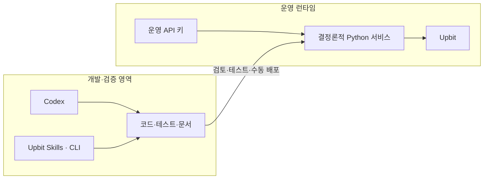
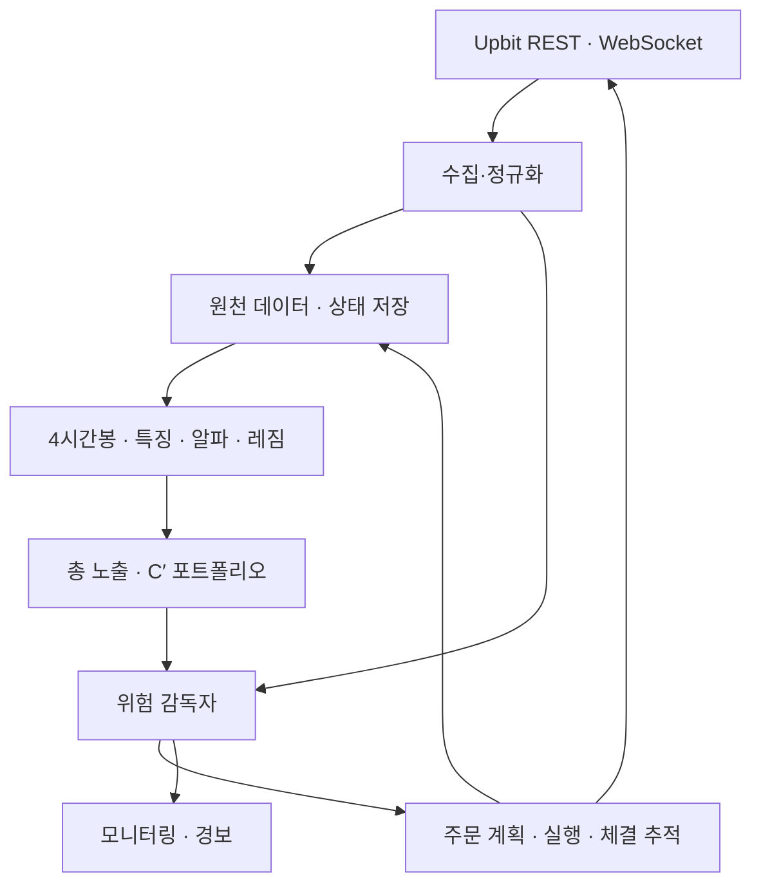
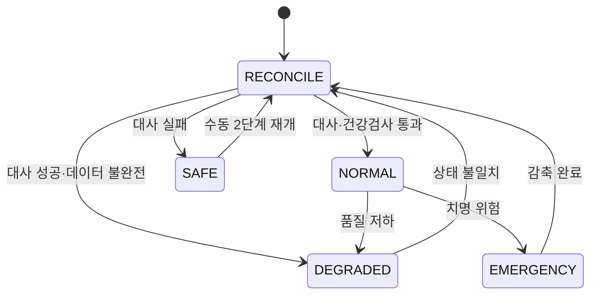
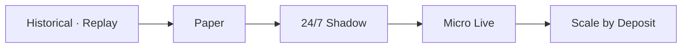

# Cassandra Project Blueprint v1.0

> 업비트 KRW 현물시장을 위한 24/7 롱·현금 자동매매 시스템

| 항목 | 내용 |
|---|---|
| 문서 상태 | 구현 기준선(Baseline) |
| 기준일 | 2026-08-22 |
| 대상 버전 | Cassandra v1.0 |
| 개발 환경 | OMEN 노트북 · Windows/WSL2 Ubuntu · VS Code |
| 운영 환경 | 서울 리전 Linux VPS · 24/7 |
| 거래 범위 | Upbit KRW 현물 · Long/Cash · 무레버리지 |
| 최우선 원칙 | 수익성보다 재현성, 안전성, 복구 가능성을 먼저 검증 |

---

## 1. 프로젝트 정의

카산드라는 업비트 KRW 현물시장에서 여러 종목의 상대적 기회를 평가하고, 시장 위험에 따라 전체 암호자산 노출을 0~100% 사이에서 조절하는 자동매매 시스템이다.

핵심 운용 원칙은 한 문장으로 정리된다.

> **완전히 닫힌 4시간봉에서만 정상적인 신규 위험을 결정하고, 실시간 위험 엔진은 언제든 위험을 줄일 수 있다.**

### 1.1 v1의 제품 목표

- API 키 없이 시작하는 읽기 전용 데이터 수집부터 실거래까지 하나의 검증 경로를 만든다.
- 연구·백테스트·페이퍼·섀도·실거래가 같은 전략 코드와 내부 데이터 타입을 사용한다.
- 24시간 켜진 클라우드 서버가 수집·추론·주문·대사·감시를 담당한다.
- OMEN 노트북은 개발, 대규모 백테스트, 모델 학습에만 사용한다.
- 자본금이 100만원이든 5,000만원 이상이든 NAV와 유동성에 맞춰 주문 크기가 자동으로 변한다.
- 장애나 재시작 뒤에도 중복 주문 없이 거래소 상태와 대사할 수 있다.

### 1.2 v1 완료의 정의

v1 완료는 “가장 최신 모델을 넣었다”가 아니라 다음 상태를 뜻한다.

1. 동일한 전략 코드가 replay, paper, shadow, live 어댑터 위에서 작동한다.
2. 24시간 연속 paper/shadow 실행에서 데이터, 의사결정, 주문, 대사, 복구 경로가 확인된다.
3. 프로세스 강제 종료, 통신 단절, 중복 이벤트, 부분 체결을 넣어도 중복 주문과 미해결 원장 불일치가 없다.
4. 비용 포함 walk-forward 결과와 2배 비용 스트레스 결과를 재현할 수 있다.
5. 운영 승격·중지·축소·롤백이 사람의 명시적 승인 아래 이루어진다.

마이크로 라이브에 들어가기 전에는 최소 1주 이상의 shadow soak test를 권장한다.

### 1.3 v1 비목표

- 공매도, 레버리지, 파생상품
- 다중 거래소 운용
- TimesNet, PatchTST, ModernTCN의 운영 Champion 투입
- 뉴스·온체인·거시 데이터의 핵심 알파 투입
- 전용 웹 대시보드
- LLM 또는 자연어 에이전트의 실시간 주문 판단
- 모델의 자동 실거래 승격
- 자동 출금

---

## 2. 확정된 설계 결정

| 영역 | v1 결정 |
|---|---|
| 시장 | Upbit KRW 현물, Long/Cash |
| 정상 의사결정 | 완전히 닫힌 4시간봉마다, 하루 6회 |
| 실시간 경로 | 시세·호가·체결·주문·잔고·장애 감시, 취소와 위험 감축 |
| 주 예측 수평선 | 7일; 의무 보유기간이나 최대 보유기간은 아님 |
| 유니버스 | 시점별 최근 30일 거래대금 상위 약 30개 적격 KRW 종목 |
| 알파 Champion | Elastic Net + LightGBM/LambdaRank |
| 레짐 Champion | 해석 가능한 연속 점수; 총 노출 0~100% |
| 종목 수 | 고정 K 없음; 엣지·비용·불확실성·유동성으로 결정 |
| 종목당 한도 | NAV 20% 절대 안전 상한; 평상시 목표 비중이 아님 |
| 현금 | 의무 하한 없음; 총 노출 엔진의 결과 |
| 위험자산 배분 | 강건 C′ 목적함수; 위험자산 슬리브 내부 합계 100% |
| 1차 모델 평가 | walk-forward Net Calmar의 구간 중앙값 |
| 2차 평가 | Net Sharpe, 기간·레짐 안정성, 2배 비용 스트레스 |
| 낙폭 목표 | OOS·스트레스 MDD 20% 이하를 목표로 하되 보장하지 않음 |
| 손절·익절 | Champion에는 고정 손절·익절 없음 |
| 운영 승격 | 자동 승격 없음; shadow 검증 후 수동 승인 |
| 클라우드 | VPS 24/7 실행, OMEN은 개발·학습 전용 |
| 자본 한도 | `max_authorized_nav` 없음; 실제 NAV에 자동 적응 |
| 운영 계좌 | 자동매매 전용 계좌/포켓, 봇 실행 중 수동 거래 금지 |

---

## 3. 시스템 경계와 설계 원칙

### 3.1 결정론적 운영 코어

운영 주문 경로에는 LLM을 넣지 않는다. Codex, Upbit Agent Skills, Upbit CLI는 개발·문서 확인·테스트·운영 절차 작성에만 사용한다. 실제 운용은 검증된 Python 코드, 버전이 고정된 모델, 승인된 설정만 실행한다.



### 3.2 공통 불변조건

- 모든 저장 시각과 판단 기준은 UTC, 사용자 표시와 보고는 KST로 한다.
- 가격·수량·수수료·잔고·주문금액은 부동소수점이 아닌 `Decimal`로 처리한다.
- 모든 의사결정에는 `as_of`, `decision_id`, 코드·설정·모델·데이터 버전을 기록한다.
- 모든 주문 의도에는 고유한 `intent_id`와 만료시각을 부여한다.
- 동일 이벤트나 의사결정이 재생되어도 결과가 바뀌거나 주문이 중복되지 않아야 한다.
- 거래소의 잔고·미체결 주문·체결 기록을 최종 진실 공급원으로 본다.
- 시작과 재시작 뒤에는 반드시 대사를 통과해야 주문할 수 있다.
- 정상 데이터 경로는 미래 정보와 생존편향을 구조적으로 차단한다.
- 거래소별 세부사항은 어댑터 뒤에 두고 전략·위험 로직에 누출하지 않는다.
- 설정과 모델은 실행 중 임의 변경하지 않고 버전 단위로 승격·롤백한다.

---

## 4. 전체 아키텍처



### 4.1 주요 서비스

| 컴포넌트 | 책임 |
|---|---|
| Market Data Collector | 공개 REST/WebSocket 수집, 재접속, gap·중복 탐지 |
| Account Stream | 주문·체결·잔고 실시간 수신 및 상태 갱신 |
| Bar Builder | 원천 이벤트로 재현 가능한 완결 4시간봉 생성 |
| Universe Builder | point-in-time 적격 종목 선정과 편입·퇴출 이력 |
| Feature Engine | 알파·레짐·위험·유동성 특징 산출 |
| Alpha Engine | 종목별 순위, 비용 차감 기대 엣지, 확신도·불확실성 |
| Regime Engine | 연속 시장 위험 점수와 총 암호자산 노출 결정 |
| Allocator | 위험자산 슬리브 C′ 비중 산출 및 fallback |
| Risk Governor | 노출·낙폭·CVaR·유동성·데이터 상태의 최종 veto |
| Execution Engine | 목표 차이, 무거래 구간, 주문 분할, 라우팅 |
| Order Tracker | 부분 체결·미체결·취소·거부·만료 상태 추적 |
| Reconciler | 내부 원장과 Upbit 잔고·주문·체결 대사 |
| Supervisor | 프로세스 상태, 자동 재시작, 시스템 상태 머신 |
| Reporter | Telegram P1/P2 경보, 이메일 일일 보고, heartbeat |

### 4.2 멀티클록 운영

| 주기 | 계산·감시 | 허용 행동 |
|---|---|---|
| 실시간 | 호가·체결·주문·잔고, 데이터 지연, 유동성 이상 | 주문 취소, 긴급 감축, 신규 위험 거부 |
| 1~5분 | 총 노출, 낙폭, CVaR, 유동성, 계좌 상태 | 유지 또는 감축만 가능 |
| 완결 4시간봉 | 특징, 알파, 레짐, C′, 정상 목표 포트폴리오 | 신규 진입·증액·감액·청산 |
| 일 1회 | 유니버스, 비용 추정, 데이터 품질, 성과 보고 | 다음 4시간 결정에 반영 |
| 정기·필요 시 | 재학습, Challenger 평가 | shadow 평가만 자동; 승격은 수동 |

---

## 5. Upbit 연동 설계

### 5.1 인터페이스 선택

- REST: 공식 `upbit-sdk`의 비동기 클라이언트를 기본으로 사용한다.
- WebSocket: 공개 시세와 비공개 주문·자산 스트림을 직접 구현한다.
- 공개 데이터 수집은 인증 없이 시작한다.
- 주문 전에는 공식 주문 가능 정보(`orders/chance`)를 활용해 실제 수수료, 주문 유형, 최소·최대 조건을 확인한다.
- 라이브 전 계약 검증에는 실제 주문을 만들지 않는 공식 주문 생성 테스트 API를 활용한다.
- API 호출 한도는 숫자를 영구 하드코딩하지 않고 응답 헤더와 최신 공식 정책을 읽어 제어한다.
- 비공개·미문서 엔드포인트는 사용하지 않는다.

### 5.2 연결 복원력

- WebSocket ping/pong, 지수 백오프, jitter, 재구독을 구현한다.
- 발생시각과 수신시각을 함께 저장해 지연과 순서 역전을 측정한다.
- sequence가 없거나 누락이 의심되면 REST snapshot으로 복구한 뒤 대사한다.
- 오래된 시세는 주문을 거부하며, 기준값은 자산·상태별 관측으로 보정한다.
- 429·418·5xx·timeout을 구분하고, 주문 제출 timeout은 무조건 재전송하지 않고 먼저 조회·대사한다.

### 5.3 API 키 보안

- 개발 키와 운영 키를 분리한다.
- 운영 키에는 조회·주문 권한만 부여하고 출금 권한은 제거한다.
- 운영 VPS의 고정 IP만 허용한다.
- 키는 Git, 노트북, 모델 파일, 로그, Codex, Upbit Skills에 노출하지 않는다.
- 운영 비밀은 VPS의 제한된 secret/env 파일 또는 클라우드 secret store에서 주입한다.
- 로그와 예외에서 Authorization, JWT, key, query hash를 마스킹한다.
- 키 유출이 의심되면 신규 위험을 막고 즉시 폐기·교체한다.

---

## 6. 투자 전략 명세

### 6.1 point-in-time 유니버스

매 의사결정 시점에 그때까지 이용 가능했던 정보만 사용해 유니버스를 구성한다.

- Upbit KRW 마켓의 최근 30일 거래대금 상위 약 30종목
- 상장 후 90일 미만 종목 제외
- 거래 유의·정지 종목 제외
- 스테이블코인 제외
- 데이터가 불완전한 종목 제외
- 잦은 교체를 막기 위한 진입·퇴출 버퍼 적용
- BTC와 ETH는 거래대상 편입 여부와 무관하게 레짐 입력에 항상 포함

“약 30개”는 유동성 후보군의 목표 규모다. 적격 조건을 만족하는 수가 적으면 억지로 채우지 않는다.

### 6.2 벤치마크

| 구분 | 벤치마크 | 목적 |
|---|---|---|
| 주 외부 기준 | Upbit 30 | KRW 주요 자산 시장 베타 비교 |
| 광범위 외부 기준 | Upbit Composite | 업비트 전체 시장 비교 |
| 진단 기준 | Upbit Altcoin Index | 알트코인 레짐 진단 |
| 단순 대안 | BTC buy-and-hold | 집중 장기보유 대비 부가가치 |
| 무투자 대안 | KRW cash | 위험을 감수한 보상 확인 |
| 내부 기준 | point-in-time 적격 유니버스 동일가중 | 종목선택·노출 엔진의 가치 분리 |
| 내부 기준 | 단순 7일 모멘텀 | 복잡한 알파의 증분 가치 확인 |
| 내부 기준 | BTC·ETH 레짐만 사용 | 종목선택과 레짐의 기여 분해 |

Upbit 공식 지수를 비공개 엔드포인트로 크롤링하지 않는다. 장기 백테스트에는 Open API로 재현 가능한 내부 시장 프록시를 사용하고, 공식 지수는 이용조건을 충족해 확보한 기간과 용도에서만 평가 기준으로 쓴다.

### 6.3 알파 Champion

알파는 횡단면 순위와 절대 비용 차감 기대수익을 함께 사용한다.

- 주 예측: 향후 7일 횡단면 순위
- 보조 예측: 1일·3일·14일 수익률, 상승확률, 불확실성
- 선형 축: Elastic Net으로 안정적·해석 가능한 신호 포착
- 비선형 축: LightGBM/LambdaRank로 상호작용과 종목 순위 포착
- 출력: `rank`, `net_edge`, `confidence`, `uncertainty`, `model_version`

주요 특징군은 다음과 같다.

- 다중 시간축 모멘텀과 단기 반전
- 거래량·거래대금·유동성·변동성
- 공격적 매수·매도 체결 흐름
- 스프레드·호가 깊이·호가 불균형
- BTC·ETH 상태와 시장 폭
- 국내외 시장 흐름·가격 괴리
- EWMA 위험, 상관관계, 7일 ES/CVaR

### 6.4 레짐 Champion

레짐 엔진은 이산적인 상승장/하락장 라벨 대신 다음 입력을 결합한 연속 점수를 만든다.

- 추세
- 시장 폭
- Upbit 주문 흐름
- 변동성
- 꼬리위험

레짐 출력은 총 암호자산 노출을 0~100% 사이에서 결정한다. 위험 악화에는 빠르게 축소하고, 회복에는 점진적으로 확대한다.

### 6.5 총 노출과 현금의 분리

1. 알파 엔진이 투자 가능한 종목을 선택한다.
2. 선택된 위험자산 슬리브의 비중 합은 100%가 된다.
3. 별도의 노출 엔진이 전체 NAV 중 위험자산 예산을 결정한다.

따라서 현금은 종목 선택 실패의 부산물이 아니라 시장 위험 판단의 결과다. 의무 현금 하한은 두지 않는다.

### 6.6 강건 C′ 배분기

위험자산 슬리브는 다음 목적함수를 푼다.

$$
\max_x \left[
\tilde{\mu}^{\top}x
-\lambda\,\mathrm{CVaR}^{regime}_{7d}(x)
-\eta\,\mathrm{Cost/Turnover}(x)
-\gamma\lVert x-x_B\rVert^2
\right]
$$

제약조건은 $x_i \ge 0$, $\sum_i x_i=1$이다.

- $\tilde{\mu}$: 강한 축소와 불확실성 조정을 거친 비용 차감 기대 엣지
- $\mathrm{CVaR}^{regime}_{7d}$: 레짐 가중 블록 부트스트랩·스트레스 기반 7일 꼬리위험
- 비용 항: 수수료, 스프레드, 슬리피지, 회전율
- $x_B$: 신뢰도와 역변동성을 결합한 anchor/fallback
- 최적화 실패 시 $x_B$, 그마저 불가능하면 동일가중 fallback

현금은 C′ 내부에 넣지 않는다. 같은 예측 불확실성을 기대수익과 위험에서 중복 처벌하지 않는다.

### 6.7 종목 수와 비중

- 동시 보유 종목 수는 고정하지 않는다.
- 6종목은 비교용 기준일 뿐 하드 리밋이 아니다.
- 보유 여부는 비용 차감 엣지, 불확실성, 유동성, 포트폴리오 분산효과로 결정한다.
- 종목당 NAV 20%는 평상시 목표가 아니라 오류 방지용 절대 상한이다.

### 6.8 자본 규모 적응

$$
NAV = KRW\ cash + \sum_i quantity_i \times price_i
$$

$$
RiskyBudget = NAV \times TotalExposure
$$

$$
Target_i = RiskyBudget \times C'_i
$$

$$
Order_i = Target_i - CurrentValue_i
$$

최소 주문, 호가 깊이, 주문장·거래대금 참여율, 예상 슬리피지, 분할주문, 무거래 구간을 자본 규모에 따라 동적으로 적용한다. 자본금 구간별로 서로 다른 전략을 만들지 않는다.

`max_authorized_nav`는 두지 않는다. 사용자의 입금은 다음 완결 4시간봉 정상 결정에 반영해 즉시 추격매수를 피한다. 출금은 다음 대사에서 NAV와 목표를 낮춘다. 수익은 NAV에 자동 복리 반영된다.

---

## 7. 주문과 체결 설계

### 7.1 정상 실행

1. 목표 포트폴리오와 거래소 대사 완료 상태의 차이를 계산한다.
2. 최소 주문, 호가단위, 실제 수수료, 스프레드, 깊이, 예상 슬리피지를 적용한다.
3. 히스테리시스와 무거래 구간으로 불필요한 회전율을 제거한다.
4. 매도·위험 감축 주문을 먼저 계획한다.
5. 정상 상황에서는 passive/limit 주문을 우선한다.
6. 확신도, 스프레드, 깊이, 목표 이탈에 따라 urgency를 조정한다.
7. 부분 체결과 잔여 주문은 새 시장 상태로 다시 평가하며 무조건 추격하지 않는다.

### 7.2 비상 실행

- 위험 감독자의 veto는 회전율 제약을 우회할 수 있다.
- 상충하는 미체결 주문을 먼저 취소한다.
- 시장 위험과 유동성을 비교해 aggressive limit 또는 market 감축을 사용한다.
- 장애가 발생했다는 이유만으로 무조건 전량 시장가 청산하지 않는다.
- 감축 뒤에는 반드시 거래소 상태와 다시 대사한다.

### 7.3 멱등성과 대사

- `decision_id + market + side + target_version`으로 안정적인 `intent_id`를 만든다.
- 주문 제출 timeout 시 동일 주문을 즉시 재전송하지 않고 identifier·UUID로 조회한다.
- 부분 체결, 취소 경합, 순서가 바뀐 이벤트를 명시적인 상태 전이로 처리한다.
- 내부 상태와 거래소가 다르면 거래를 멈추고 `RECONCILE`로 들어간다.
- 봇 외부 주문이 발견되면 수동 거래로 간주하고 경보 후 대사한다.

---

## 8. 위험·장애 상태 머신

| 상태 | 의미 | 주문 정책 |
|---|---|---|
| `NORMAL` | 데이터·계좌·거래소 정상 | 정상 진입·증액·감액 허용 |
| `DEGRADED` | 일부 데이터 지연, API 품질 저하, 불확실성 증가 | 신규 위험 금지, 취소·감액만 허용 |
| `RECONCILE` | 내부 원장과 거래소 상태 불일치 | 정상 주문 중지, 잔고·주문·체결 재구성 |
| `SAFE` | 신뢰할 수 있는 운용 불가 | 미체결 취소 시도, 신규 주문 금지 |
| `EMERGENCY` | 치명적 낙폭·유동성·시장 위험 | 상충 주문 취소 후 위험 신속 감축 |



### 8.1 전략 수준 drawdown governance

- 연속 레짐·CVaR 감축 위에 별도의 전략 서킷브레이커를 둔다.
- warning에서는 신규 노출 증가를 막고 기존 위험을 감축한다.
- critical에서는 통제된 현금화와 잠금을 수행한다.
- 재시작은 사람의 2단계 확인이 필요하다.
- 낙폭은 입출금 영향을 제거한 NAV로 계산한다.
- 임계치는 임의 숫자가 아니라 OOS·스트레스 분포에서 보정한다.
- 확정된 임계치는 모델 버전과 함께 고정하며 운용 중 불리하다고 완화하지 않는다.

---

## 9. 데이터와 백테스트

### 9.1 데이터 계층

| 계층 | 내용 | 성질 |
|---|---|---|
| Raw | REST/WebSocket 원응답, 수신시각, 요청·연결 메타데이터 | append-only, 재처리 가능 |
| Canonical | 표준 candle, trade, quote, orderbook, market status | 스키마 버전·품질 플래그 |
| Feature | point-in-time 알파·레짐·위험 특징 | `as_of`, 코드·데이터 버전 |
| Decision | 예측, 노출, 목표 비중, 위험 지시 | 완전한 판단 근거와 hash |
| Execution | 주문 의도, 거래소 주문, 체결, 수수료, 대사 결과 | 감사 가능한 영속 원장 |

연구 데이터는 Parquet + DuckDB를 기본 제안으로 하고, 운영 주문·상태 원장은 PostgreSQL을 기본 제안으로 한다. Redis나 Kafka는 필요성이 입증되기 전에는 도입하지 않는다.

### 9.2 2계층 백테스트

#### 장기 전략 백테스트

- 4시간봉 기반
- point-in-time 유니버스
- 상장, 유의, 거래중단, 상장폐지 이력 반영
- 수수료, 스프레드, 보수적 슬리피지 반영
- purging/embargo를 포함한 walk-forward 학습·검증
- 다양한 시장 레짐과 2배 비용 스트레스
- 과도한 현금 보유로 성과지표를 꾸미지 않았는지 다중 벤치마크로 확인

#### 미시구조 검증

- 실제 호가·체결 데이터를 지금부터 지속 수집
- paper/shadow에서 fill probability, 시장충격, 역선택 추정
- 예상 비용과 실현 비용의 차이를 기록
- 추정치를 장기 백테스트 비용 모델에 되먹임

### 9.3 미래정보 방지 체크

- 각 특징의 `event_time`, `available_time`, `as_of`를 구분한다.
- 4시간봉은 완결 뒤에만 특징으로 사용한다.
- 유니버스와 시장 상태는 당시 관측 가능한 값만 사용한다.
- 상장폐지 종목을 역사에서 제거하지 않는다.
- 학습·검증 경계에서 7일 label overlap을 purge한다.
- 하이퍼파라미터와 비용 모델을 최종 OOS 결과에 맞춰 되돌려 조정하지 않는다.
- 모델, 데이터 snapshot, 설정, 코드 commit으로 결과를 재현한다.

---

## 10. 모델 평가와 수명주기

### 10.1 목적함수와 선택 기준

운영 목적은 명목수익률 극대화가 아니라 다음을 균형 있게 반영한 순수익의 안정적 축적이다.

- 비용 차감 기대수익
- 레짐별 7일 CVaR와 하방위험
- 수수료·스프레드·슬리피지
- 회전율과 포지션 불안정성

모델 선택의 1차 기준은 walk-forward 구간별 Net Calmar 중앙값이다. 2차 기준은 Net Sharpe, 기간·레짐 안정성, 2배 비용 스트레스다. OOS·스트레스 MDD 20% 이하는 목표이지 보장이나 손실 확약이 아니다.

### 10.2 Champion–Challenger

- 재학습과 평가 작업은 자동화할 수 있다.
- 새 모델은 동일한 walk-forward와 비용 조건에서 Champion과 비교한다.
- 통계적으로뿐 아니라 경제적으로 의미 있는 개선이 있어야 한다.
- 새 모델은 먼저 shadow로 운용한다.
- 실거래 승격은 수동 승인만 허용한다.
- 이전 Champion과 설정을 즉시 복구할 수 있어야 한다.
- 승인된 model artifact hash와 다르면 운영 시작을 거부한다.

### 10.3 v1 이후 Challenger

- TimesNet
- PatchTST
- ModernTCN
- HMM 또는 딥러닝 기반 레짐 모델
- 변동성 조정 trailing stop
- 정교한 호가 단위 체결·시장충격 모델
- 뉴스·온체인·거시 특징

뉴스는 우선 수익 예측기보다 거래 veto·위험 감축 신호로 검토한다. 모든 신규 데이터·모델은 ablation과 OOS 검증을 통과해야 한다.

---

## 11. 관측성과 원격 운영

### 11.1 필수 지표

- 프로세스와 외부 heartbeat
- WebSocket 연결 상태와 마지막 수신시각
- 완결봉 지연, gap, 중복, 역전 이벤트
- REST 오류율, rate-limit 여유, retry 수
- 현재 운영 상태(`NORMAL` 등)
- 실제·목표 총 노출, 종목별 목표 이탈
- NAV, 현금흐름 조정 수익률, MDD
- 주문 거부·취소·부분 체결·미체결 경과시간
- 수수료, 예상·실현 슬리피지
- 내부 원장과 거래소 잔고·주문의 차이
- 디스크와 데이터베이스 건강도
- 코드·설정·데이터·모델 버전

### 11.2 경보와 보고

| 등급 | 예시 | 채널 |
|---|---|---|
| P1 Critical | heartbeat 상실, `SAFE`/`EMERGENCY`, 대사 실패, 인증 실패, 중복 주문 가능성 | Telegram 즉시 |
| P2 Warning | 데이터 지연, 비정상 슬리피지, 장기 미체결, 저장공간 부족 | Telegram 묶음 알림 |
| Daily | NAV, 수익률, MDD, 노출, 포지션, 회전율, 수수료, 슬리피지, 모델 버전 | Email |

원격 명령은 상태 조회, pause, 미체결 취소, reduce-only, 비상 감축으로 제한한다. 임의 종목 매수·매도는 제공하지 않는다. 잠금 해제와 재가동은 2단계 확인을 요구한다.

---

## 12. 기술 스택 — Sprint 0 제안 기본값

아래 항목은 전략 결정과 달리 설치·호환성 검증 뒤 ADR로 확정한다.

| 영역 | 제안 기본값 |
|---|---|
| 편집기 | VS Code + WSL 확장 |
| 로컬 OS | WSL2 Ubuntu |
| 언어 | Python 3.12 |
| 패키지·환경 | `uv` + `pyproject.toml` + lockfile |
| REST | 공식 `upbit-sdk` 비동기 클라이언트 |
| WebSocket | 비동기 직접 어댑터 |
| 데이터 처리 | Polars, PyArrow |
| 연구 저장 | Parquet, DuckDB |
| 운영 원장 | PostgreSQL + migration |
| 모델 | scikit-learn, LightGBM |
| 최적화 | CVXPY 또는 동등한 검증 가능한 solver |
| 설정·계약 | Pydantic, YAML/TOML |
| 테스트 | pytest, Hypothesis, recorded replay, fake exchange |
| 배포 | Docker Compose + 수동 production approval |
| CI | GitHub Actions: lint, type check, test, secret scan, image build |
| 로그 | 구조화 JSON 로그 + correlation ID |
| 서버 | 서울 리전 Ubuntu VPS, 2 vCPU/4GB/80GB급부터 시작 |

학습과 대규모 백테스트는 OMEN에서 수행하고, 운영 VPS는 CPU 추론·수집·주문·감시에 집중한다.

---

## 13. 추천 저장소 구조

```text
cassandra/
├── pyproject.toml
├── uv.lock
├── .env.example
├── configs/
│   ├── base.yaml
│   ├── research.yaml
│   ├── paper.yaml
│   ├── shadow.yaml
│   └── live.yaml
├── docs/
│   ├── architecture/
│   ├── decisions/
│   └── runbooks/
├── src/cassandra/
│   ├── domain/
│   ├── adapters/upbit/
│   ├── data/
│   ├── features/
│   ├── models/alpha/
│   ├── models/regime/
│   ├── portfolio/
│   ├── risk/
│   ├── execution/
│   ├── storage/
│   ├── monitoring/
│   └── apps/
├── tests/
│   ├── unit/
│   ├── contract/
│   ├── integration/
│   ├── replay/
│   └── failure/
├── research/
├── scripts/
└── infra/
```

### 13.1 핵심 계약

```python
class MarketDataPort(Protocol):
    async def stream_public(self) -> AsyncIterator[MarketEvent]: ...
    async def fetch_candles(
        self, markets: list[str], until: datetime
    ) -> list[Candle]: ...


class TradingPort(Protocol):
    async def balances(self) -> list[Balance]: ...
    async def open_orders(self) -> list[ExchangeOrder]: ...
    async def place(self, intent: OrderIntent) -> ExchangeOrder: ...
    async def cancel(self, order_id: str) -> ExchangeOrder: ...


class DecisionEngine(Protocol):
    def decide(
        self, snapshot: PointInTimeSnapshot, as_of: datetime
    ) -> TargetPortfolio: ...


class RiskGovernor(Protocol):
    def evaluate(
        self, account: AccountState, market: MarketState
    ) -> RiskDirective: ...


class Reconciler(Protocol):
    async def reconcile(
        self, internal: LedgerState, exchange: ExchangeState
    ) -> ReconciliationResult: ...
```

주요 타입은 버전 필드를 포함한다.

- `AlphaForecast`: 시장, 기준시각, 예측수평선, 순기대수익, 순위, 불확실성, 모델 버전
- `RegimeDecision`: 총 노출, 위험 예산, 판단 사유, 모델 버전
- `TargetPortfolio`: 총 노출과 위험자산 내부 비중을 분리
- `RiskDirective`: `ALLOW`, `REDUCE_ONLY`, `HALT`, `EMERGENCY_REDUCE`
- `OrderIntent`: intent/decision ID, 방향, 가격·수량, urgency, 만료시각, 사유
- `SystemEvent`: 발생·수신시각, 출처, 스키마 버전, 추적 ID

---

## 14. 테스트 전략

| 계층 | 검증 내용 |
|---|---|
| 단위·속성 | NAV, 입출금 조정 수익률, 슬리브 합계 1, 노출 0~1, 종목당 20% 절대 상한, 반올림, 봉 마감 |
| 데이터 계약 | REST/WebSocket 스키마 변화, timestamp, gap, 중복, 역전, 시장 상태 |
| 시계열 | purging/embargo, point-in-time 특징, label overlap, 재학습 시점 |
| 백테스트 회귀 | 동일 버전의 결과 재현, 비용 전후, 2배 비용, 다중 벤치마크 |
| 주문 통합 | 부분 체결, 미체결, 취소 경합, timeout, 429/418, 순서 역전 |
| 장애 주입 | 네트워크 단절, 프로세스 강제 종료, DB 지연, stale quote, 원장 불일치 |
| 보안 | secret scan, 출금 권한 부재, 키 분리, 로그 마스킹 |
| 운영 인수 | pause, cancel, reduce, kill switch, 2단계 restart, rollback |

Upbit에 완전한 공개 샌드박스가 없다는 전제에서 recorded replay와 fake exchange를 기본으로 사용하고, 실제 API 계약은 읽기 전용 호출과 공식 주문 생성 테스트로 확인한다.

---

## 15. 구현 로드맵과 완료 기준

| 단계 | 핵심 작업 | 주요 산출물 | 완료 기준 |
|---|---|---|---|
| Sprint 0 기반 | WSL2, VS Code, Git/GitHub, Python 환경, 비공개 저장소, CI, ADR | 설치 가능한 골격, lockfile, 설정 스키마, 테스트·보안 체크 | 로컬·CI의 동일 명령 성공, 비밀키 0건, 모드 분리 |
| Sprint 1 읽기 전용 데이터 | REST 과거 데이터, WebSocket ticker/trade/orderbook, point-in-time 유니버스 | append-only raw, 4시간봉, gap·중복 검사 | 무키 수집, 재시작 이어받기, 동일 입력→동일 봉 |
| Sprint 2 연구·백테스트 | 7일 label, 특징, 비용, 벤치마크, purged walk-forward | 재현 가능한 엔진·보고서 | 누수·생존편향 검사, 비용·2배 스트레스 재현 |
| Sprint 3 Champion | Elastic Net+LightGBM, 연속 레짐, 노출, C′ | 학습 파이프라인, registry, 평가기 | Net Calmar 중앙값·2차 지표·레짐 안정성 산출 |
| Sprint 4 실행·복구 | 공통 주문 엔진, paper, 부분 체결, 대사, 상태 머신 | idempotent 원장, normal/emergency 실행 | 고장 주입·재시작 후 중복 0, 완전 대사 |
| Sprint 5 24/7 shadow | 클라우드 배포, 실시간 신호·가상주문, 예상·실현 비용 비교 | heartbeat, Telegram, email, 비용 보정 | 24시간 인수시험 + 권장 1주 soak, 미해결 P1 0건 |
| Sprint 6 micro live | 소액 실주문, 운영키/IP, kill switch, rollback | live 어댑터, 런북, 실체결 보고 | 중복·미대사 0, 비용 허용범위, 복구·비상시험 통과 |
| 이후 규모 확대 | 코드 변경 없이 추가 입금, 유동성에 따른 분할 | 규모별 실행 보고 | 수동 검토·승인 후 단계 확대 |

---

## 16. 배포 게이트



모든 화살표는 자동 전환이 아니라 사람의 승인이다.

- Historical → Paper: 누수·생존편향 검사와 비용 포함 walk-forward 재현
- Paper → Shadow: 주문 상태, 대사, 재시작, emergency reduce 시험 통과
- Shadow → Micro Live: 미해결 P1 0건, 비용 모델과 관측 실행 품질의 합치
- Micro Live → Scale: 수익률뿐 아니라 슬리피지, 오류율, 대사, MDD, 운영 부담 검토
- 모델·실행 엔진 변경: 영향받는 이전 게이트부터 재검증

---

## 17. 주요 리스크 레지스터

| 리스크 | 예방·완화 | 대응 조건 |
|---|---|---|
| 미래정보·생존편향 | point-in-time, 상장폐지 포함, purged walk-forward | 데이터 계보 불명확 시 결과 폐기 |
| 비용 과소평가 | 2계층 백테스트, 호가·체결 수집, 2배 비용 | 실현 슬리피지 지속 초과 시 신규 위험 중단 |
| 과적합·레짐 변화 | 단순 Champion, 레짐별 평가, Challenger shadow | 경계 초과 시 fallback 또는 노출 축소 |
| API·WebSocket 장애 | gap 감지, 재접속, stale-data veto | 신선도 한계 초과 시 신규 매수 금지 |
| 중복·유실 주문 | idempotency, identifier, 거래소 기준 대사 | 불일치 시 `RECONCILE` |
| 급락·유동성 고갈 | 레짐/CVaR, circuit breaker, emergency 경로 | critical trigger 시 통제 감축·수동 잠금 |
| 키 유출 | 출금 권한 제거, 키 분리, 고정 IP, 로그 마스킹 | 의심 즉시 키 폐기·교체 |
| 클라우드 장애 | 자동 재시작, 영속 상태, 외부 heartbeat | 상태 확인 전 신규 위험 금지 |
| 비인가 모델 | 버전·hash 고정, 수동 promotion | 승인 hash 불일치 시 실행 거부 |
| 수동 거래 충돌 | 전용 포켓, 거래소를 source of truth로 사용 | 외부 주문 발견 시 경보·대사 |
| 지수 접근 제한 | 비공개 endpoint 배제, 내부 프록시 | 이용조건 미충족 시 입력에서 제외 |
| 정책·규제 변화 | API 약관·국내 규정 정기 검토 | 적법성 불명확 시 live 중단 |

---

## 18. 현재 `cassandra-v0.1` 골격의 처리 방침

현재 작업공간에는 읽기 전용 Upbit REST, SQLite paper 원장, 멱등성 주문 ID, fail-closed live broker 등 유용한 안전 골격이 있다. 다만 최신 합의 이전의 임시 설정과 미완성 부분이 있으므로 **그대로 실거래 기반으로 승격하지 않는다.**

| 현재 상태 | v1 기준 처리 |
|---|---|
| 유니버스 `target_size = 42` | 최근 30일 거래대금 상위 약 30 + point-in-time 필터로 교체 |
| 종목당 `max_asset_weight = 0.25` | NAV 20% 절대 fail-safe로 교체 |
| `min_cash_buffer_krw = 100000` | 의무 현금 하한 제거; 총 노출 엔진으로 분리 |
| 고정 `max_order_krw`, `max_plan_notional_krw` | NAV·호가·유동성 기반 동적 실행 제약으로 교체 |
| REST 공개 조회만 구현 | 공식 SDK REST + 공개/비공개 WebSocket 어댑터 추가 |
| 즉시 체결 paper broker | 부분 체결·미체결·취소·시장충격 가능한 simulator로 교체 |
| live broker 비활성 | 검증 게이트 통과 뒤 별도 adapter로 구현; 기본값은 계속 비활성 |
| SQLite 단일 원장 | 도메인 로직은 재사용 검토, 운영 원장은 제안 PostgreSQL로 이전 |
| 선언된 CLI·README·tests 부재 | Sprint 0에서 설치·실행·검증 계약부터 완성 |

기존 파일을 일괄 폐기하지 않는다. `domain`, idempotency, fail-closed 원칙은 테스트를 붙여 선별 재사용하고, 합의와 충돌하는 고정 한도와 단순 체결 가정은 제거한다.

---

## 19. 아직 숫자로 보정해야 할 항목

아래는 개발 방향을 다시 정해야 하는 질문이 아니라 데이터와 시험으로 정할 calibration 항목이다.

- 레짐 점수 → 총 노출 매핑과 축소·회복 속도
- C′의 $\lambda$, $\eta$, $\gamma$와 shrinkage 강도
- 무거래 구간과 히스테리시스
- 호가·ADV 참여율, child order 크기, 주문 TTL
- stale-data 임계값과 WebSocket 복구 시간
- drawdown warning/critical 임계값
- 모델 학습 lookback, 재학습 주기, embargo 길이
- shadow와 micro live에서 허용할 실행비용 오차 범위
- VPS 사업자, 백업·secret 관리의 구체 서비스

각 숫자는 OOS·stress·shadow 관측으로 정하고 ADR 또는 버전 설정에 근거와 함께 고정한다.

---

## 20. 바로 다음 행동

다음 작업은 코드 작성이 아니라 **Sprint 0 설치 진단**이다. OMEN 노트북의 Windows PowerShell에서 아래 네 명령을 실행하고 결과를 그대로 공유한다.

```powershell
wsl --status
wsl -l -v
git --version
code --version
```

결과에 따라 다음 순서로 한 단계씩 설치한다.

1. WSL2 Ubuntu
2. VS Code + WSL 확장
3. Git 설정과 GitHub 인증, 비공개 저장소
4. Python 3.12 + `uv`
5. 프로젝트 골격·CI·secret scan
6. API 키가 필요 없는 Upbit 읽기 전용 데이터 수집기

---

## 21. 공식 구현 참고자료

- [Upbit 개발자 센터](https://docs.upbit.com/kr)
- [Upbit API Rate Limits](https://docs.upbit.com/kr/reference/rate-limits)
- [Upbit WebSocket 가이드](https://docs.upbit.com/kr/reference/websocket-guide)
- [주문 가능 정보 조회](https://docs.upbit.com/kr/reference/available-order-information)
- [주문 생성 테스트](https://docs.upbit.com/kr/reference/order-test)
- [공식 Upbit Python SDK](https://github.com/upbit-official/upbit-sdk-python)
- [공식 Upbit Agent Skills](https://github.com/upbit-official/upbit-agent-skills)
- [Upbit 30 지수](https://datalab.upbit.com/indexes/IDX.UPBIT.UPBIT30)

---

## 22. 변경 통제

이 문서는 Cassandra v1.0 구현의 기준선이다. 다음 항목을 바꿀 때는 코드만 수정하지 않고 ADR과 본 문서의 버전을 함께 올린다.

- 거래 시장·상품·레버리지 범위
- 정상 의사결정 주기와 신규 위험 허용 규칙
- 현금·총 노출 구조
- 목적함수와 모델 선택 기준
- 안전 상한, 상태 머신, circuit breaker 정책
- 실거래 승격·롤백 권한
- API 키 권한과 보안 경계

파라미터 calibration은 설정 버전으로 관리하되, 운영 중 성과를 좋게 보이기 위해 과거 임계치를 소급 변경하지 않는다.
